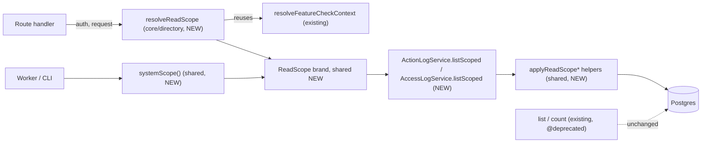

# Fail-Closed Service Read Scope

Extends: `.ai/specs/2026-07-28-audit-log-read-tenant-scope-fail-closed.md` (its "Follow-up" asks for a spec for the shared root cause)
Extends: `.ai/specs/implemented/2026-05-29-org-scope-fail-open-authorization-hardening.md` (keeps its route-level deny helpers; adds the service-level counterpart it deferred)

## TLDR

**Key Points:**
- Today, read services such as `ActionLogService.list` and `AccessLogService.list` take `tenantId` / `organizationId` as **optional** filters and treat a missing value as "no restriction". Safety depends on every route remembering to deny an empty scope first; three leaks in one module came from routes that did not.
- Proposed (future behavior): services take a **required, branded `ReadScope`** that says explicitly *all tenants*, *one tenant with all / some / no organizations*, or *nothing*. "Forgot to scope" can no longer look like "superadmin".

**Scope:**
- A `ReadScope` type plus query helpers in `@open-mercato/shared`.
- A `resolveReadScope` resolver in `core/directory`, and a named `systemScope()` for workers/CLI.
- Pilot in `audit_logs`: `ActionLogService` and `AccessLogService` gain `listScoped` / `countScoped`; their three routes migrate; `list` / `count` are deprecated.
- Out of scope, tracked as follow-ups: the cross-repo inventory, migrating callers in other modules, and removing the deprecated methods.

**Concerns:**
- Public service signatures change, so the deprecation protocol in `BACKWARD_COMPATIBILITY.md` applies.
- TypeScript branding can be bypassed by casts. A small CI allowlist check covers the one constructor that must stay exported across packages.

## Overview

Open Mercato enforces tenant and organization isolation mostly at the route layer: a route resolves the caller's scope (`resolveFeatureCheckContext`, `resolveOrganizationScopeForRequest`), denies empty or invalid scopes (`requireResolvedTenantScope`, `resolveSingleOrganizationIdOrDeny`), then calls a service with plain optional ids. The service has no way to tell an unrestricted caller from one that forgot to scope, because both arrive as `undefined`.

This spec moves the decision into a value the service requires. Audience: platform and module developers who write custom (non-`makeCrudRoute`) read paths. Benefit: a missing or empty scope fails closed by construction, not by convention.

> **Market Reference**: Django's per-request tenant managers (`django-tenants`, `django-scopes`) make unscoped queries raise unless code explicitly enters `scopes_disabled()`; Rails' `acts_as_tenant` raises `ActsAsTenant::Errors::NoTenantSet` when `require_tenant` is on. **Adopted:** the explicit, named opt-out (`systemScope()` ≈ `scopes_disabled()`) and failing closed when scope is missing. **Rejected:** ambient/thread-local scope (Node request scoping is already handled by DI containers, and implicit global state hides which call sites are unrestricted) and ORM-global filters for now (124 files use raw Kysely, which bypasses them; see Alternatives).

## Problem Statement

`ActionLogService.buildListQuery` (`packages/core/src/modules/audit_logs/services/actionLogService.ts:496-497`) adds predicates only when values are truthy:

```ts
if (parsed.tenantId) query = query.where('action_logs.tenant_id', '=', parsed.tenantId)
if (parsed.organizationId) query = query.where('action_logs.organization_id', '=', parsed.organizationId)
```

`AccessLogService.list` (`accessLogService.ts:418-425`) does the same for tenant, and returns an empty page only when a caller explicitly passes `organizationIds: []`.

Evidence that the convention "routes deny first" keeps failing:

| Incident | Missing value | What leaked | Fixed by |
|---|---|---|---|
| #3817 / #3818 | `tenantId` (tenant-less principal with `view_tenant`) | Decrypted action logs of **every tenant** | Route guard `requireResolvedTenantScope` (spec 2026-07-28) |
| #10432 | `organizationId` (explicitly empty org scope with `view_tenant`) | Every organization's action logs incl. snapshots, list + CSV export | Route guard `resolveSingleOrganizationIdOrDeny` |
| `record_locks` follow-up | `organizationId` (null passed to `findLatestActionLogWithScopeFallback`) | Latest action log id + conflict data for a known resource id | Not yet fixed |

The #6932 hardening (2026-10-07) recorded the intended invariant: "`organizationId: undefined` remains exclusive to unrestricted scope". Nothing enforces it. #10432 slipped through because those routes obtained the fallback indirectly (`resolveFeatureCheckContext().organizationId`), which the pattern-based audit did not match.

## Proposed Solution

1. **`ReadScope` (shared).** A branded, discriminated union describing exactly what a caller may read, plus helpers that turn it into Kysely and MikroORM predicates. `none` compiles to a no-row predicate.
2. **One resolver (core/directory).** `resolveReadScope({ container, auth, request })` derives the scope from the same inputs routes use today and reproduces their current decisions exactly. `narrowReadScope(scope, organizationId)` implements today's "`?organizationId=` narrows only within the allowed set".
3. **Named system scope.** `systemScope({ tenantId })` and `systemScope.allTenants()` for workers, CLI and other code with no request principal: greppable and visible in review.
4. **Scoped service methods.** New `listScoped(scope, filters)` / `countScoped(scope, filters)` where `filters` no longer accepts `tenantId` / `organizationId`. Old `list` / `count` stay, unchanged and `@deprecated`, for at least one minor version.
5. **Pilot only.** Migrate `audit_logs` (both services, three routes). The inventory of other services, other-module callers, and removal of the deprecated methods are follow-ups.

### Design Decisions

| Decision | Rationale |
|---|---|
| Scope covers **tenant and organization** | Both fail-open paths exist in the same service (#3817 tenant, #10432 org). Covering one leaves the other class open. |
| `orgs` **excludes** tenant-level rows (`organization_id IS NULL`) | Matches today: `organization_id = X` and `$in` never match null, so scoped users already do not see them. Zero visible change. |
| Branded type; constructors are `resolveReadScope`, `systemScope`, `testScope` | A hand-written `{ kind: 'all' }` does not compile. The brand follows the existing `unique symbol` precedent in `packages/shared/src/lib/commands/transaction-lifetime.ts`. |
| Low-level constructor `unsafeCreateReadScope` exported from a separate subpath and allowlisted in CI | `resolveReadScope` lives in `core`, the brand in `shared`, so one constructor must cross the package boundary. A seconds-long grep check restricts its importers. |
| New `listScoped` method instead of changing `list` | Additive; existing callers, including third-party modules, keep working through the deprecation window. |
| Actor narrowing (`actorSubject`, `actorUserId`) stays a **filter**, not scope | It is a per-feature visibility rule (`view_self` vs `view_tenant`), not isolation; mixing them would bloat the type. |
| Resolver preserves current single-org narrowing (restricted user with no selection reads `allowedIds[0]`, per `resolveFeatureCheckOrganizationId`) | Widening to all allowed orgs would be a behavior change. It is tracked by #6337 and stays out of this spec. |
| Type named `ReadScope` | `OrganizationScope` already names two different types (`shared/lib/auth/principal-service.ts:57`, `shared/lib/search/availability.ts:4`) plus the directory one; a fourth meaning would confuse. |

### Alternatives Considered

| Alternative | Why Rejected |
|---|---|
| Keep the route-level convention and audit harder | Three incidents show audits miss indirect forms; it keeps safety dependent on memory. |
| Make `tenantId` / `organizationId` required strings on `list` | Cannot express "all organizations" or "all tenants" without a sentinel; superadmin and workers would break or invent magic values. |
| MikroORM global filters / Postgres row-level security | Defense in depth worth a later spec, but 124 non-test files use raw Kysely (bypasses ORM filters) and RLS needs per-connection session variables across web, workers, CLI and migrations. Far larger blast radius. |
| Plain (unbranded) union + review | Anyone can write `{ kind: 'all' }` to silence a 403 — the same convention problem in a new shape. |
| Change `list` in place (breaking) | Violates the deprecation protocol; third-party callers break in one release. |

## User Stories / Use Cases

- **A module developer** writes a custom list route and **cannot call the audit-log service without a scope**, so they cannot accidentally ship a tenant-wide read.
- **A worker author** needs a tenant-wide read and **writes `systemScope({ tenantId })`**, which reviewers see and can question.
- **A security reviewer** **greps for `systemScope` / `unsafeCreateReadScope`** to list every unrestricted read path, instead of auditing every call site.
- **A restricted employee** with an emptied organization visibility list **gets no rows**, whatever route they hit, without each route needing its own guard.

## Architecture



Takeaway: the scope decision is made once (resolver or `systemScope`), carried as a value the compiler requires, and applied by one helper. The deprecated path is untouched until removal.

### `ReadScope` shape (`packages/shared/src/lib/auth/readScope.ts`)

```ts
declare const readScopeBrand: unique symbol

export type ReadScopeData =
  | { kind: 'allTenants' }
  | { kind: 'tenant'; tenantId: string; organizations: OrganizationReadScope }
  | { kind: 'none' }

export type OrganizationReadScope =
  | { kind: 'all' }
  | { kind: 'some'; ids: readonly [string, ...string[]] }

export type ReadScope = ReadScopeData & { readonly [readScopeBrand]: true }
```

- An empty organization set is not representable as `some`; it normalizes to top-level `none`.
- `systemScope` has no production caller in the pilot (the three migrated routes all use the resolver); it ships with unit tests so follow-up migrations of workers and CLI can use it.
- Exported helpers: `systemScope({ tenantId })`, `systemScope.allTenants()`, `isNoneScope(scope)`, `applyReadScopeToKysely(query, scope, { tenantColumn, organizationColumn })`, `readScopeToMikroFilter(scope, { tenantField, organizationField })`.
- `none` → Kysely `where(sql\`false\`)`, MikroORM `{ id: { $in: [] } }`. Callers may also short-circuit with `isNoneScope` to skip the query (as `AccessLogService` already does).
- Subpath `@open-mercato/shared/lib/auth/readScope/unsafe` exports `unsafeCreateReadScope(data)`; allowlisted importers: `core/directory/utils/readScope.ts`, `shared/lib/testing/readScope.ts` (`testScope`).

### Resolver (`packages/core/src/modules/directory/utils/readScope.ts`)

`resolveReadScope({ container, auth, request })` truth table. It must match today's route behavior exactly; Phase 2 freezes it with a table-driven test.

| Caller state | Today | `ReadScope` |
|---|---|---|
| No auth | 401 before scope | (route keeps returning 401; resolver not called) |
| `tenantId` null, not superadmin | 403 (`requireResolvedTenantScope`) | `none` |
| `tenantId` null, superadmin | cross-tenant read | `allTenants` |
| `allowedIds: []` or `filterIds: []` | 403 (`resolveSingleOrganizationIdOrDeny`) | `none` |
| `allowedIds: null` and no selected org | whole tenant | `tenant` + `all` |
| selected org, or default org resolved | that org | `tenant` + `some [org]` |

`narrowReadScope(scope, requestedOrganizationId)` returns `some [requested]` when the requested org lies inside the scope (or the scope is `all`), otherwise the scope unchanged — today's `queryOrgId` behavior in the audit-log routes.

Routes may still return 403 for `none` where the documented contract says so (the audit-log routes do since #10432); services return empty results for `none`.

### Commands & Events

None. Read-path only.

## Data Models

No schema, entity or migration changes.

## API Contracts

No HTTP contract changes: same routes, query parameters, response shapes and status codes as after #10432. The changes are TypeScript service contracts:

| Surface | Change | BC class |
|---|---|---|
| `ActionLogService.listScoped(scope: ReadScope, filters: ActionLogScopedFilters)` | New | Additive |
| `ActionLogService.countScoped(scope, filters)` | New | Additive |
| `AccessLogService.listScoped(scope, filters: AccessLogScopedFilters)` | New | Additive |
| `ActionLogService.list` / `count`, `AccessLogService.list` | `@deprecated`, behavior unchanged | Deprecation (removal ≥1 minor later) |
| `ActionLogScopedFilters` = `actionLogListSchema.omit({ tenantId, organizationId })`; `AccessLogScopedFilters` likewise (also omits `organizationIds`) | New exported types | Additive |
| `@open-mercato/shared/lib/auth/readScope`, `/readScope/unsafe`, `@open-mercato/shared/lib/testing/readScope` | New import paths | Additive |
| `@open-mercato/core/modules/directory/utils/readScope` | New import path | Additive |

DI keys `actionLogService` / `accessLogService` are unchanged.

## 📝 Delta

No observable HTTP behavior changes. Phase 3 begins with characterization tests that freeze current route behavior (status codes and the service predicates for every row of the resolver truth table) before the routes switch to `listScoped`; the same tests must pass after the switch.

## Internationalization (i18n)

None. No user-facing strings; errors keep their existing messages.

## UI/UX

None.

## Migration & Compatibility

- **Deprecation protocol** (`BACKWARD_COMPATIBILITY.md`): `list` / `count` keep working with identical behavior, carry `@deprecated` JSDoc pointing to `listScoped`, and are listed in `UPGRADE_NOTES.md` with a before/after snippet. Removal is a follow-up (see Follow-ups), no earlier than one minor release after the pilot ships, and only once no in-repo callers remain.
- **In-repo callers outside `audit_logs`** keep calling the deprecated `list` during the pilot: `sales/api/document-history/route.ts:98`, `customers/api/deals/[id]/route.ts:186`, `warranty_claims/lib/replacementOrderUndo.ts:28`. They migrate in follow-up PRs, one module per PR (see Follow-ups).
- **Third-party modules** see deprecation warnings only (TypeScript `@deprecated` strike-through), no runtime change.
- **Backports:** none. This is a forward-looking hardening; the route-level fixes (#10432 and earlier) are what release lines receive.

## Implementation Plan

### Phase 1: `ReadScope` primitives in shared
1. Add `packages/shared/src/lib/auth/readScope.ts` (type, `systemScope`, `isNoneScope`, `readScopeToMikroFilter`, `applyReadScopeToKysely`) and `readScope/unsafe.ts`. Unit tests: every variant produces the expected predicate; `none` yields no rows; a hand-built literal fails to type-check (`// @ts-expect-error` test).
2. Add `packages/shared/src/lib/testing/readScope.ts` with `testScope(data)`.
3. Add `scripts/check-read-scope-constructor.mjs` (grep: `readScope/unsafe` imported only from the allowlist) and wire it into `yarn lint`. Runs in seconds.

### Phase 2: resolver in core/directory
1. Add `resolveReadScope` and `narrowReadScope` in `packages/core/src/modules/directory/utils/readScope.ts`, built on `resolveFeatureCheckContext` plus the `isSuperAdmin` read from `audit_logs/api/audit-logs/readScope.ts`.
2. Table-driven unit test covering every truth-table row, plus `narrowReadScope` inside/outside the allowed set.

### Phase 3: `audit_logs` pilot
1. Characterization tests first: for `actions`, `actions/export`, `access` routes, assert status and the service query for every truth-table row (extending `api/__tests__/{actions,export,access}.route.test.ts`). They must pass on the unchanged code.
2. Add `listScoped` / `countScoped` to `ActionLogService`; `buildListQuery` takes the scope through `applyReadScopeToKysely`; `list` / `count` map their optional ids onto the same builder, unchanged in behavior. Service unit tests for every scope kind, including `none` returning no rows without decrypting anything.
3. Add `AccessLogService.listScoped`; same approach.
4. Migrate the three routes to `resolveReadScope` + `narrowReadScope` + `listScoped`. Keep `requireResolvedTenantScope` and the #10432 403 responses so the HTTP contract is identical. Characterization tests stay green.
5. Mark `list` / `count` `@deprecated`; add the `UPGRADE_NOTES.md` entry; update the `packages/core/AGENTS.md` "Access Control" section with a one-line rule: "read services take a `ReadScope`".

### File Manifest

| File | Action | Purpose |
|---|---|---|
| `packages/shared/src/lib/auth/readScope.ts` | Create | Type, system scope, predicate helpers |
| `packages/shared/src/lib/auth/readScope/unsafe.ts` | Create | Allowlisted constructor |
| `packages/shared/src/lib/testing/readScope.ts` | Create | `testScope` for tests |
| `scripts/check-read-scope-constructor.mjs` | Create | CI allowlist check |
| `packages/core/src/modules/directory/utils/readScope.ts` | Create | `resolveReadScope`, `narrowReadScope` |
| `packages/core/src/modules/audit_logs/services/actionLogService.ts` | Modify | `listScoped`, `countScoped`, deprecate `list`/`count` |
| `packages/core/src/modules/audit_logs/services/accessLogService.ts` | Modify | `listScoped`, deprecate `list` |
| `packages/core/src/modules/audit_logs/data/validators.ts` | Modify | Scoped filter schemas |
| `packages/core/src/modules/audit_logs/api/audit-logs/{actions,actions/export,access}/route.ts` | Modify | Use resolver + `listScoped` |
| `UPGRADE_NOTES.md` | Modify | Deprecation entry |
| `package.json` (root) | Modify | Wire `check-read-scope-constructor` into `yarn lint` |
| `packages/core/AGENTS.md` | Modify | One-line rule: read services take a `ReadScope` |
| `packages/shared/src/lib/auth/__tests__/readScope.test.ts` | Create | Predicate and brand tests |
| `packages/core/src/modules/directory/utils/__tests__/readScope.test.ts` | Create | Resolver truth table |
| `packages/core/src/modules/audit_logs/api/__tests__/{actions,export,access}.route.test.ts` | Modify | Characterization tests |
| `packages/core/src/modules/audit_logs/services/__tests__/` | Modify/Create | `listScoped` / `countScoped` per scope kind |

### Testing Strategy

- Unit: shared helpers (predicates per variant, brand type test), resolver truth table, service methods per scope kind.
- Characterization: route-level tests written before the switch and kept green after it.
- Integration: existing audit-log integration specs must stay green. New cross-route empty-scope coverage belongs to the separate manifest-driven test spec (see Follow-ups).

## Risks & Impact Review

### Tenant & Data Isolation Risks

#### Resolver diverges from today's route logic
- **Scenario**: `resolveReadScope` maps a caller state differently than the routes did (e.g. selected org outside `allowedIds`), widening or narrowing reads.
- **Severity**: High
- **Affected area**: The three audit-log routes, later every migrated route.
- **Mitigation**: Truth-table unit test (Phase 2) plus route characterization tests written before the switch (Phase 3.1).
- **Residual risk**: A caller state not in the table. Accepted; the table is derived from the resolver's actual inputs, and unknown states map to `none`.

#### Brand bypass through casts
- **Scenario**: Code writes `{ kind: 'allTenants' } as unknown as ReadScope`, or imports `unsafeCreateReadScope` outside the allowlist.
- **Severity**: Medium
- **Affected area**: Any migrated service.
- **Mitigation**: CI allowlist for the unsafe import; `as unknown as ReadScope` is a visible code smell and greppable; reviewers check for it.
- **Residual risk**: A deliberate cast survives review. Accepted; it is no worse than today and far more visible.

#### Deprecated `list` keeps the fail-open behavior
- **Scenario**: A new or third-party caller uses `list` during the deprecation window and forgets to deny an empty scope.
- **Severity**: Medium
- **Affected area**: Callers of the deprecated methods.
- **Mitigation**: `@deprecated` strike-through, `UPGRADE_NOTES.md`, follow-up migrations and removal; the separate manifest-driven test catches leaks on any path.
- **Residual risk**: Window lasts at least one minor release. Accepted as the cost of the deprecation protocol.

### Migration & Deployment Risks

#### Public service contract churn
- **Scenario**: Third-party modules depend on `list` signatures.
- **Severity**: Low
- **Affected area**: External modules using `actionLogService` / `accessLogService`.
- **Mitigation**: Additive methods only; the follow-up removal follows the deprecation protocol.
- **Residual risk**: None beyond the planned removal.

### Operational Risks

#### Query cost
- **Scenario**: `organization_id IN (...)` with many ids is slightly heavier than `=`.
- **Severity**: Low
- **Affected area**: Tenants with many organizations, once multi-org `some` scopes are used.
- **Mitigation**: The pilot keeps single-org narrowing (one id); existing indexes on `organization_id` apply.
- **Residual risk**: Negligible.

### Data Integrity / Cascading Failures

Not applicable: read-only change, no writes, events or external calls.

## Follow-ups (out of scope, linked)

1. **Manifest-driven empty-scope test** — separate spec: run every `GET` route from the generated API manifest as an empty-scope principal and as an org-A principal; assert no org-B data. Catches leaks on paths this spec does not migrate.
2. **Single-record load scoping** (deferred Q2-b of the 2026-05-29 spec) — separate spec: `findOne({ id })` / `findOneWithDecryption` take a `ReadScope`.
3. **`record_locks`** — issue: `findLatestActionLogWithScopeFallback` re-queries tenant-wide on a null organization; fix with `isExplicitlyEmptyOrganizationScope`, later `ReadScope`.
4. **Inventory of optional-scope services** — tracking issue: ledger of every service method under `packages/**` (and `external/official-modules/**` when present) whose tenant/organization predicate is optional or truthiness-gated, classified migrate / safe-by-construction / system-only, with one issue per module to migrate.
5. **Migrate the other `ActionLogService.list` callers** — one issue each: `sales/api/document-history/route.ts`, `customers/api/deals/[id]/route.ts`, `warranty_claims/lib/replacementOrderUndo.ts`.
6. **Remove deprecated `list` / `count`** — issue gated on one minor release after the pilot and zero in-repo callers; note it in `UPGRADE_NOTES.md`.
7. **Multi-org reads** (#6337) — once `some` scopes exist, restricted multi-org users could read all allowed orgs instead of `allowedIds[0]`; product decision, separate change.

## Final Compliance Report — 2026-11-23

### AGENTS.md Files Reviewed
- `AGENTS.md` (root)
- `packages/core/AGENTS.md`
- `packages/shared/AGENTS.md`
- `.ai/specs/AGENTS.md`
- `BACKWARD_COMPATIBILITY.md` (deprecation protocol, as summarized in root `AGENTS.md`)

### Compliance Matrix

| Rule Source | Rule | Status | Notes |
|---|---|---|---|
| root AGENTS.md | Never expose cross-tenant data / always filter by `organization_id` | Compliant | The purpose of the spec; `none` is no-row by construction |
| root AGENTS.md | Follow `BACKWARD_COMPATIBILITY.md` before touching contract surfaces | Compliant | Additive methods, `@deprecated` + bridge ≥1 minor, `UPGRADE_NOTES.md`, this spec carries Migration & Compatibility |
| root AGENTS.md | No `any`; derive types from zod | Compliant | Scoped filter types via `.omit` on existing schemas; `ReadScope` is a precise union |
| root AGENTS.md | Ask before changing public contracts / touching multiple modules | Compliant | Architect green light obtained; pilot limited to `audit_logs` + shared + directory helper; other modules in follow-up PRs, one per module |
| packages/shared/AGENTS.md | Shared has zero domain dependencies | Compliant | `ReadScope` and helpers are infrastructure; the resolver that reads directory scope lives in `core/directory` |
| packages/shared/AGENTS.md | Check for existing utilities before adding helpers | Compliant | Reuses `resolveFeatureCheckContext`, `isExplicitlyEmptyOrganizationScope` semantics; distinct name avoids the existing `OrganizationScope` collisions |
| packages/core/AGENTS.md | Use `findWithDecryption` for encrypted entities | Compliant | Unchanged; services keep their decryption paths |
| packages/core/AGENTS.md | API routes export `openApi` | Compliant | No route contract change |
| .ai/specs/AGENTS.md | Required sections and changelog | Compliant | All present |

### Internal Consistency Check

| Check | Status | Notes |
|---|---|---|
| Data models match API contracts | Pass | No data model change |
| API contracts match UI/UX section | Pass | No HTTP or UI change |
| Risks cover all write operations | Pass | No writes |
| Resolver truth table matches Problem Statement incidents | Pass | #3817/#3818 → `none`; #10432 → `none` |
| Every phase leaves the app working | Pass | Phases 1–2 add code not yet called by routes; Phase 3 is behavior-preserving behind characterization tests. Phases 1–3 ship together as one capability |
| Scope cohesion | Pass | Fresh-context review: inventory, other-module migrations and removal moved to Follow-ups |

### Non-Compliant Items

None.

### Verdict

- **Fully compliant**: Approved — ready for implementation.

## Changelog

### 2026-11-23
- Initial specification. Decisions agreed with the requester: tenant and organization in one scope; `orgs` excludes tenant-level rows; branded type with allowlisted constructor; manifest-driven test and single-record loads as separate linked specs; pilot limited to `ActionLogService` + `AccessLogService`. Architect approved the direction.
- Applied fresh-context scope-cohesion review: moved the cross-repo inventory, other-module migrations and deprecated-method removal to Follow-ups; completed the File Manifest; noted `systemScope` has no production caller in the pilot.
