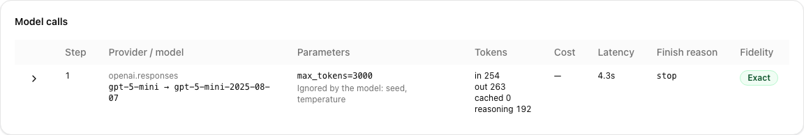
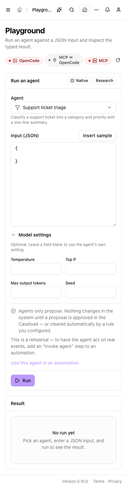

# B-10 review and QA — PASS

Final head: `b19f3aed6c`; base: `5bf400d343`. Independent code review: **approve**. QA: **approve**. Runner: local, production app, isolated pgvector database.

- Rebased, preserved B-3 refusal behavior, removed the duplicate error class and stale dispatcher-drop test, reconciled upgrade notes. Every commit carries `B-10`.
- Full unit gate: **51/51 tasks passed**. Final-head targeted enterprise **142/142**, workflows **22/22**, typecheck **42/42**.
- Package build → generate → package build, i18n sync/usage, production app build, template parity and diff check passed. Client-boundary report generated; no boundary introduced by this PR.
- Call-settings integration **3/3**, trace integration **3/3**, workflow invoke-denied integration **1/1**; **zero skips in the final selected cases**.
- Real `INVOKE_AGENT` workflow `b0bb8a89-abe1-4574-be43-f2e5d824d31b` completed on `gpt-5-mini`. Run `d3f25915-ca2f-4c06-aed5-8e7a8fda8074`: `max_tokens=3000`; `seed` and `temperature` accurately listed as ignored.
- Browser QA: collapsed defaults, native settings fields, 390px layout without overflow, and real workflow trace display passed. Prior PR's 15-step UI evidence, including Polish and validation/blank settings, reused as authorized.

The full gate and live QA used `11cd987c5c`. B-8 merged into the base during testing; a final clean rebase preserves all four PR patches exactly (`git range-diff`: all `=`). Targeted tests/typecheck passed again on the final head. No B-10 case remains unexercised. Repository-wide pre-existing unit skips remain unchanged.

## Screenshots

## Nonblocking review notes

`agents.mdx:377` still describes all file agents as OpenCode; qualify it by runtime in a follow-up. `hasCallSettings` now has only a test consumer; the playground helper's existing comment overstates field-specific feedback. Neither blocks approval.

## Environment notes

Initial missing AGENTS flag, an unsuitable network-idle wait on an SSE page, and the runner/app signing-secret mismatch were corrected without source changes. The final relevant checks passed. The fork enterprise contribution guard is excluded per the user's explicit instruction.
